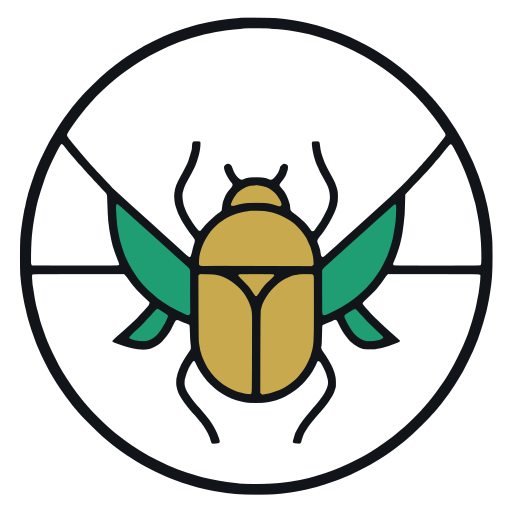
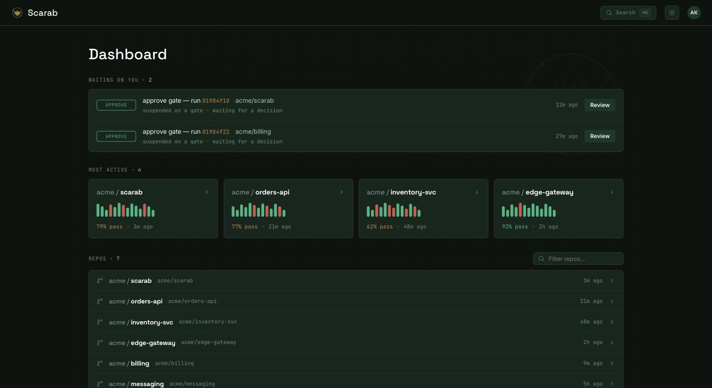
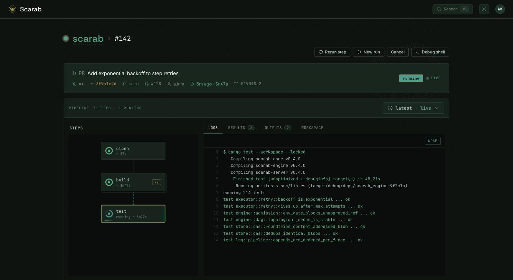

<div align="center">

<picture>
  <source media="(prefers-color-scheme: dark)" srcset="ui/brand/logo/scarab-emblem-dark-square.svg">
  
</picture>

# Scarab

**A modern CI engine for Kubernetes — forge-native, on a durable core.**

A CI system for Kubernetes with the forge pieces built in: webhooks, pipelines
in your repo, PR checks, secrets, approvals and a UI. Each run is stored as
durable **state** in Postgres, so when the control plane restarts, the run
resumes instead of starting over. Written in Rust.

<br>

[](LICENSE)
[](#building)
[](docs/adr/0005-tenancy-and-k8s-only.md)
[](https://demo-scarab.ahiravan.dev/)
[](#status)

[Live demo](https://demo-scarab.ahiravan.dev/) · [Context](CONTEXT.md) · [ADRs](docs/adr/) · [Positioning](docs/positioning.md) · [Run it locally](#local-dev)

</div>

---

<div align="center">



<sub>The dashboard: an **action inbox** of runs suspended on a gate, **recently-visited repos** as pass/fail status cards, and the recency-sorted repo list. ⌘K to jump anywhere.</sub>

</div>

CI tools fall into two groups, and neither does the whole job. **Workflow engines** (Argo,
Tekton, Temporal) have a durable, crash-safe core, but they aren't CI: you build the forge
integration, in-repo config, PR checks, identity, secrets, DSL and UI yourself.
**Forge-native CIs** (GitHub Actions, GitLab, Woodpecker, Drone) give you all of that, but
underneath they are job runners. If the control plane restarts mid-run, the run is orphaned
or starts again from scratch.

Scarab is built to be **both**: a forge-native CI with the batteries included, on a control
plane that stores each run as durable **state** instead of a fire-and-forget process. The
engine is a crash-safe state machine on Postgres (the DBOS/Temporal pattern).
When the control plane restarts, the run resumes from its last completed step, and each step
runs exactly once. Self-hosted CIs like Woodpecker and Drone strand in-flight builds on a
restart: they stay stuck in `running` and leave containers behind
([woodpecker-ci#3427](https://github.com/woodpecker-ci/woodpecker/issues/3427),
[drone#2189](https://github.com/harness/drone/issues/2189)). A Scarab run picks up where it
left off.

We don't think durability on its own is a reason to pick a CI, but several useful features
fall out of it: resuming a run, restarting a single step, approval gates that survive a
restart, and an event log you can inspect. It matters most as pipelines get longer and more
autonomous (agents, multi-day workflows, long review gates),
where "the job died, click re-run" is no longer good enough. Scarab holds a suspended
run at near-zero cost and resumes exactly where it paused.

**Lineage.** Scarab's design owes a lot to [Woodpecker](https://woodpecker-ci.org/), a lean,
forge-native CI without enterprise overhead. Woodpecker's limits shaped it just as much: the
many backends it has to support, and the pace a volunteer project can keep up. Supporting
only Kubernetes drops the extra backends on purpose, and a small team building with AI tools
can now move faster than that.

## Status

The core engine is proven. The live I/O at the edges (real forges, real clusters) is still
being wired up. Scarab is not a shipped product yet.

- **Proven (against real Postgres).** The durable engine: crash-mid-run → resume, exactly-once
  step execution, restart-a-step, durable gates, content-addressed workspace, `invoke`
  inlining, scheduler (concurrency/fairness/supersede), secrets + fork-PR lockout, and a
  self-hosted OIDC issuer. The workspace test suite passes locally.
- **Proven against a *fake* forge.** The forge-native flow end-to-end: signed webhook →
  in-repo `.scarab` config → run → checks posted back → OAuth-gated reads.
- **Implemented, not yet battle-tested against a live forge.** Two real forge adapters —
  GitHub (`/webhooks/github`) and Forgejo (`/webhooks/forgejo`) — each with HMAC webhook
  ingest and commit-status posting over real HTTP (multi-adapter). The end-to-end
  loop against a live forge is wired but not yet hardened.
- **In progress.** Live-Kubernetes Pod execution and re-attach (tested only via `#[ignore]`d
  live-cluster paths), the results-egress sidecar image, and a CI job that runs the Rust
  suite on push.

The durable state machine is real and tested. Anything that depends on *a live forge* or
*a live cluster* is not yet demonstrated. We build in thin end-to-end (tracer-bullet)
slices. See [docs/positioning.md](docs/positioning.md) for what we do and don't claim, and
why.

## Live demo

**[demo-scarab.ahiravan.dev](https://demo-scarab.ahiravan.dev/)** runs the real thing: the
control plane, the workspace service, and every step Pod on a single Oracle Always Free ARM
box under k3s, reached through a Cloudflare Tunnel, with Cloudflare R2 as the object store,
for $0/month. The deployment mode is [`deploy/demo-oracle/`](deploy/demo-oracle/), and its README
is the operator guide.

Sign in with GitHub and you land as **Viewer**. Viewer has no Write, so you can look around
but you can't dispatch a run. The server has no anonymous read path. It's a demo box on
free-tier capacity that can be reclaimed, so there is no SLA.

## Documentation

The full docs site, **[docs.scarab](https://thulasi-ram.github.io/scarab-ci/)**, is built
with Astro Starlight and published to GitHub Pages on tag. It has the
getting-started guides, the pipeline authoring/config reference, the generated OpenAPI, and
all ~40 ADRs. In-repo, the same sources live under:

- **[CONTEXT.md](CONTEXT.md)** — the core idea, the durability contract, non-goals, and the
  **ubiquitous language** every crate/API/UI must use.
- **[docs/adr/](docs/adr/)** — ~40 Architecture Decision Records (why each major
  decision was made).
- **[docs/positioning.md](docs/positioning.md)** — what we do and don't claim, and why.
- **Issues** — tracked in [git-bug](https://github.com/git-bug/git-bug) (embedded in this
  repo): `git-bug bug` to list, `git-bug termui` for the TUI.

## The run view

<div align="center">



<sub>A run is durable **state**: the step DAG, live logs and an append-only event timeline.
Here a flaky step was retried automatically, then the run paused on a manual
<code>deploy-prod</code> gate, where it waits at near-zero cost until someone approves.</sub>

</div>

## What makes it different

|  |  |
|---|---|
| **Forge CI and engine together** | A forge-native CI (DSL, secrets, approvals, identity, UI) on a durable engine. You don't have to build a CI on top of a workflow engine, or accept a job runner with nothing durable underneath. |
| **Runs are state, not processes** | A DBOS-pattern durable state machine on Postgres. When the control plane restarts, the run resumes from its last completed step, and each step runs exactly once. |
| **Keyless identity** | Forge-agnostic OIDC, with Scarab itself as an OIDC issuer for keyless federation to your cloud. *(GitHub + Forgejo adapters implemented; the live-forge loop is not yet hardened; see Status.)* |
| **A real DSL** | You write YAML with CEL expressions; it compiles to a typed IR, which is the actual DSL. Every pipeline is a flat recursive DAG: `invoke` handles reuse and matrix is a modifier. |

Every other design decision gets checked against the durable core. The reason to use
Scarab, though, is that the CI and the engine come as one piece. See
[docs/positioning.md](docs/positioning.md) for how we describe Scarab and what we don't
claim yet.

## Design at a glance

| Aspect | Choice |
|---|---|
| Core | DBOS-pattern durable state machine on **Postgres** (Rust); object store for blobs |
| Execution | **Pod-per-step**, content-addressed workspace (per-file merkle CAS); k8s-only |
| Pipeline model | **Flat recursive DAG** (`Pipeline → Step`); `invoke` = reuse; matrix = modifier |
| DSL | Typed **IR** (the real DSL) + YAML frontend + **CEL** expressions |
| API | **REST/OpenAPI + SSE** (dogfooded by UI & CLI) + internal gRPC |
| Code | **Hexagonal**, compiler-pure domain crates + per-vendor adapter crates; one converged binary |
| Security | Forge-agnostic OIDC identity; **Scarab as OIDC issuer** for keyless federation |
| UI | SolidJS + generated OpenAPI client |

## Workspace layout

```
CONTEXT.md            ubiquitous language + system overview
docs/adr/             architecture decision records
crates/
  scarab-engine       durable core (pure): DAG state machine, scheduler, ports
  scarab-pipeline     IR, YAML→IR, CEL, validation (pure)
  scarab-forge        ForgePort + canonical Event/Status (pure)
  scarab-identity     Authenticator, OidcIssuer, RBAC (pure)
  scarab-secrets      SecretProvider (pure)
  scarab-storage      ObjectStore + Cas (pure)
  scarab-project      Org/Repo/Project/Environment (pure)
  scarab-db-postgres · scarab-secrets-postgres · scarab-storage-s3   state/blob adapters
  scarab-executor-{k8s,local} · scarab-forge-{github,forgejo}        exec/forge adapters
  scarab-testkit      fakes: FakeClock / InMemoryDb / FakeExecutor
  scarab-server       composition root: axum + OpenAPI + SSE; role runner
  scarab-cli          CLI (generated from OpenAPI)
```

## Building

```sh
cargo check --workspace
cargo run -p scarab-server -- --help
```

## Local dev

Config for the local stack lives in `deploy/local-proc/.env` — gitignored (env
files may hold secrets), seeded from the committed `deploy/local-proc/.env.example`
the first time you run a recipe. Edit your copy to change it. A root `.env.local`
can hold optional per-machine overrides (e.g. a dev `SCARAB_ADDR`) — it's
gitignored and loaded by your shell/direnv, not by the recipes themselves. Real
secrets for the in-cluster dogfood live in its own gitignored
`deploy/local-helm/.env`.

```sh
just ui       # Vite dev server on http://localhost:5173, proxies /v1 → server
just serve    # scarab-server in the foreground against the dev stack (needs `just up`)
```

Every setting (`SCARAB_ADDR`, `SCARAB_DATABASE_URL`, `SCARAB_S3_*`, `SCARAB_API_URL`,
…) comes from that file — point elsewhere by editing it. Auth is disabled in dev
(`SCARAB_DEV_INSECURE=1`), so every request is an Owner.

## Full dev stack (k8s)

One command brings up the two stateful dependencies (Postgres + MinIO), a
[kind](https://kind.sigs.k8s.io/) cluster for step Pods, and `scarab-server` in
converged mode, then submits a pipeline and watches it complete:

```sh
just up      # Postgres + MinIO (docker compose) + kind + scarab-server (background)
just demo    # POST a one-step pipeline, poll until it succeeds, print logs
just down    # tear it all down
```

Requires `docker`, `kind`, `kubectl`, `cargo`, and `python3`. The kind cluster's
kubeconfig is written to `deploy/local-proc/.kubeconfig` and used only via
`KUBECONFIG`, so Scarab never touches an ambient (e.g. production) context.
Postgres is published on **55432** to avoid clashing with a host Postgres on
5432. Config is entirely env-driven (`SCARAB_DATABASE_URL`, `SCARAB_S3_*`,
`KUBECONFIG`, `SCARAB_NAMESPACE`) — see `Justfile` and `deploy/local-proc/`.

Without Docker/kind, the server still runs API-only against a local Postgres and
a filesystem object store (`--object-dir`); the background driver is skipped
until a cluster is reachable.

## Helm dogfood (in-cluster, colima)

To test the **real chart and published image** inside a cluster (a production-like
setup, e.g. Scarab-on-Scarab), use the `local-helm` mode:

```sh
just local-helm             # pull + deploy the latest ghcr `edge`
just local-helm sha-<sha>   # pull + deploy a specific published SHA
just local-helm local       # build server+clone+sidecar+wsfetch from the tree, then deploy
```

Needs `deploy/local-helm/.env` and kube context `colima`; see
`deploy/local-helm/README.md`.

> **Running or testing Scarab locally: use the `just` recipes as the canonical
> entrypoints** (`just up`/`demo`/`down`, `just local-helm`, `just test`) rather
> than hand-rolled `docker`/`kubectl`/`helm` commands — they carry the right
> env, isolated kubeconfig, image source, and colima guards. Missing something?
> Add a recipe. (Agents: this is also in `CLAUDE.md`.)

## API contract workflow

`openapi.json` (committed at the repo root) and the generated TS client
(`ui/scarab-web-ui/src/api/schema.ts`) are **checked for drift in CI**:
the build fails if either is out of date. After changing any route or DTO:

```sh
cargo run -p scarab-server -- --emit-openapi openapi.json
cd ui/scarab-web-ui && npm run gen && npm run typecheck
```

Full-route coverage is enforced by the test
`route_table_equals_the_openapi_spec` (`crates/scarab-server/tests/step_up_routes.rs`):
a registered route missing from the spec (no `#[utoipa::path]` annotation),
or a spec operation with no route, fails the suite.

## License

[GNU Affero General Public License v3.0](LICENSE) (`AGPL-3.0-only`). Running a
modified Scarab as a network service obliges you to offer users its source.

## References

- [ADR-0001 — CI as durable execution](docs/adr/0001-ci-as-durable-execution.md)
- [ADR-0005 — Tenancy & deployment; Kubernetes as the only backend](docs/adr/0005-tenancy-and-k8s-only.md)
- [ADR-0040 — Documentation site: Astro Starlight, in-repo, DESIGN.md-branded](docs/adr/0040-documentation-site.md)
- [ADR-0046 — Forge auth is adapter-internal; GitHub + Forgejo adapters in v1](docs/adr/0046-forge-auth-and-multi-adapter.md)
- [ADR-0054 — Product surface: embedded UI, run cancellation, API/CLI truthfulness](docs/adr/0054-product-surface-serving.md)
