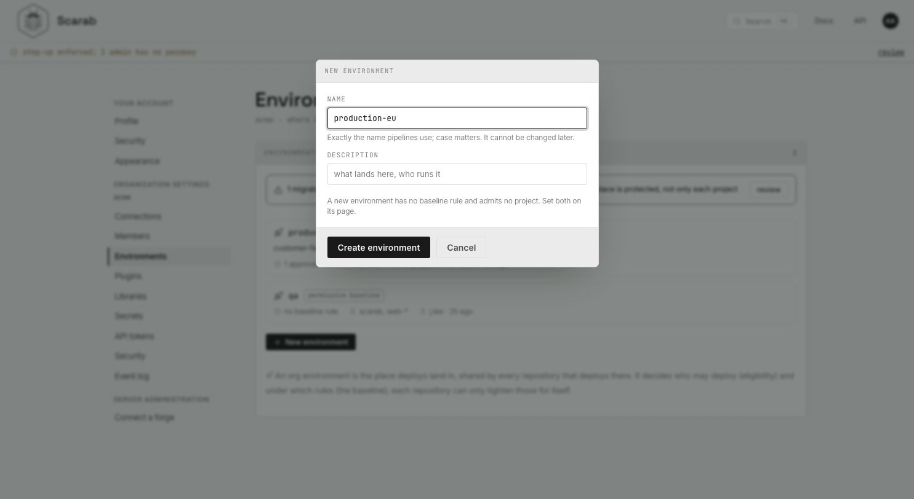

import Doodle from '../../../components/Doodle.astro';

<Doodle icon="shield-check" size={200} rotate={-8} opacity={0.18} top="7rem" right="-2rem" />

## What an Environment is

An Environment (for example `staging` or `prod`) is an **org-level set of rules and scoped
secrets that governs the Runs which name it**. A pipeline names one with a top-level
`environment:`:

```yaml
environment: prod
```

That one line pulls in approval, allowed refs, secrets and privilege grants, which an org admin
defines **once** for every Project in the org. Because the rules live in the Environment and not in
the pipeline YAML, you get separation of duties: the pipeline *asks* to run in `prod`, and the
Environment *decides* whether it may, whatever the YAML says.

Naming an Environment does not make a Run a deploy. A smoke test that needs staging credentials or
a backup that needs prod credentials runs in an Environment too. To mark the Runs that deploy, use
[`deploy: true`](/scarab-ci/usage/pipeline-syntax/#deploys-deploy-true). Scarab governs the Run that
deploys and keeps no record of what is live where after that Run ends; that is your CD tool's job.
See [Deploying with Argo CD](/scarab-ci/usage/deploying-with-argo-cd/) for a pipeline that waits
until its change is live.

Protection is **optional per Environment**. An Environment with no rules (typically `staging`) only
scopes secrets. Add approvers and it becomes gated.



## Who may run in it

An Environment admits Runs only from the Projects on its **eligibility** list: *all projects*, or
an explicit list (project-name globs allowed). A new Environment starts with **no** eligible
Projects, and a pipeline that names an unknown Environment, or one that doesn't admit its Project,
is refused before any Pod starts.

Org admins create Environments and edit their eligibility and rules, under the org's
**Settings › Environments** (`/orgs/<org>/settings/environments`).

## View and edit an Environment

Each Environment has a read-only page, `/orgs/<org>/settings/environments/<name>`: its display
name, description, the baseline, **Projects that may use** it, and, under **Project overlays and
grants**, each project's overlay and privilege grant. Its **Edit** button opens `…/<name>/edit`, where you change the display name,
the description, the baseline and eligibility (one **Save** sends only the parts you changed),
each project's privilege grant, and delete the Environment. Deleting it, or withdrawing a grant,
asks you to type the Environment's name.

## Name and display name

An Environment's **name** cannot be changed. It is the key every pipeline's `environment:` uses,
and the OIDC subject a Run presents to a cloud provider contains it
(`scarab:org/<org>/repo/<repo>/env/<name>/ref/<ref>`), so cloud trust policies match on it.

The **display name** is what lists, headings and pickers show, with the name beside it, for
example *Production (EU) · prod*. It is optional (blank shows the name) and an org admin can
change it at any time without a step-up. It may not hold control characters, or invisible bidi
or zero-width characters that would make it read as another name.

## Duplicate an Environment

To move to another name, use **Duplicate** on the Environment's page. It asks for the new name and,
optionally, a display name (blank uses the old one's with " (copy)" added), and needs a step-up,
because it copies secrets and the projects that may use it. The new Environment gets:

- the baseline protection rules and eligibility;
- every project's overlay and privilege grant;
- the Environment's secrets set per project, with their values.

The old Environment is not changed; it stays until an admin deletes it. Run and approval history
and the Cache stay with it. When the copy is made, the page lists what it did not copy:

- the projects whose Runs used the old Environment: their pipelines' `environment:` must change;
- the policies whose `match.environments` selects the old name and not the new one;
- cloud trust policies: a role that trusts `…/env/<old>/…` must also trust `…/env/<new>/…`.

If the copy fails part-way, nothing is left behind: the secrets are copied first and removed
again if the Environment cannot be created. A name already in use, or secrets already stored
under the new name, is refused (409). So is a second Duplicate to a name while the first is still
running, before it writes anything.

## The rules it holds

An Environment's baseline protection rules are:

- **`approvers`**: principals whose approval is required. Approvals are recorded on a gate, not in
  a separate table: the Run's **Environment approval gate** collects distinct approver identities
  on the Run's durable event log (`GateApproved { step, by }`), and the Steps after it wait until
  the approvals are in. This survives restarts, and approvals cannot be forged. See
  [The approval gate](#the-approval-gate).
- **`allowed_refs`**: glob patterns for the git refs that may run here; checked at **Run
  creation**, so a disallowed ref is rejected before any Pod launches (blank = any ref).
- **`require_reason`**: a human dispatch (`manual`/`api`) into this Environment must carry a
  reason; push, pull request, tag, release and cron are exempt.
- **`wait_timer_s`**: a minimum wait in seconds on the Environment approval gate, counted from
  when the gate's `needs` finished. The gate releases when the approvals are in and the timer has
  run out; an approval given early counts. The timer applies only with approvers: the API refuses a
  non-zero timer on an Environment with none, and a timer stored before that check does nothing.
- **Approval gate settings** (baseline only): what happens when a pipeline has no gate (add one, the
  default, or refuse the Run), the expiry of the gate the Environment adds, how many of the
  approvers must approve (default: every one), and the maximum approval age (default 24 hours).
  Where only some of the approvers must approve, adding an approver needs a step-up, as removing
  one does.

On the edit page these settings are in the **Approval gate** section: **When a pipeline has no
approval gate** (**Add an approval gate** or **Refuse the Run**), **Added gate expiry** (blank: no
expiry), **Required approvals** (1 to the number of approvers; blank: every one) and **Maximum
approval age**, all in seconds. The **Wait timer** field is disabled while the Environment has no
approvers, and an Environment with a timer and no approvers shows a warning that the timer does
nothing until approvers are added. Lowering the count, raising the age, or lengthening or removing
the expiry loosens the baseline and needs a step-up.

A Project's admins can add a **tighten-only overlay** for their Project: more approvers (each one
required, whatever the baseline's count), a narrower ref pattern, `require_reason`, a longer timer. An overlay can make that Project's Runs
stricter than the org baseline, never looser.

Two governed settings are granted **to one Project within one Environment**, and fail closed: the
privilege whitelist (which image digests may use the `add-capabilities` or `privileged` grants) and
permission for a raw `k8s_overlay`. Raw overlay permission gives that Project's pipeline authors
control of the step Pod spec, including privileged containers, host mounts and the Pod's
ServiceAccount, so grant it only where you would grant those.

A Run that names an Environment is also never cancelled by newest-wins: a newer push to the same
branch does not cancel it, and its concurrency group queues even if the pipeline declares
`cancel-in-progress`.

## The approval gate

A Step **uses the Environment's authority** when it declares `secrets:`, requests a governed grant
or a `k8s_overlay`, asks for `forge_token: write`, or is marked `deploy: true` (itself, or its
whole pipeline). In an Environment with approvers, no such Step runs until an approver releases an
**Environment approval gate** upstream of it.

An Environment approval gate is a `gate: manual` with a Step after it, through `needs`, that uses
the Environment's authority. Only these gates need the Environment's approvers and a step-up. Any
other `manual` gate in the Run is a plain gate: anyone with write on the Project releases it with
one approval. Which gates are approval gates is decided when the Run is created and stored with it;
the Run page marks them, and `scarab validate` lists them. On the Run page an approval gate reads
**Environment approval gate** with the Environment's display name, the gate the Environment added
reads **added by** the Environment, and once the approvals are in, a gate with a wait timer shows
when it releases.

When a pipeline has no `manual` gate in front of a Step that uses the authority, the Environment
**adds one**: a `manual` gate with the id `environment-approval` (with `-2`, `-3`, … appended if the
pipeline uses that id), in front of the earliest such Steps, with their `needs` combined. Its
origin names the Environment. It works like any other gate: approve, reject, expiry and rerun.
A Step that never starts, because its `when:` is false or a Step it needs is excluded that way,
gets no gate and adds none of its `needs` to the gate.
With `deploy: true` on the whole pipeline the added gate comes first, before the build.

```yaml
environment: prod
steps:
  - { id: build, image: rust:1, command: [cargo, build] }
  # prod adds `environment-approval` here, needing `build`
  - { id: ship, image: deployer, deploy: true, needs: [build] }
```

To keep every wait in the YAML, set the Environment's missing-gate mode to **refuse**: a Run with
such a Step is refused, and the refusal names the Steps and the gate to add.

Every launch of a Step that uses the authority checks the approval again, reruns and retries
included. The launch is refused (the Step fails `Config` with the reason) when the Run's ref is no
longer in the allowed refs, or when no approval gate upstream of it has released with the approver
set unchanged since its approvals were given and no longer ago than the maximum approval age. One
such gate is enough: a QA approval gate released two days ago does not refuse a deploy whose own
approval gate released a minute ago. An `external`, `timer` or `plugin` gate is never an approval gate, so a Step
behind only those is refused at launch. Steps with no released approval gate upstream get the
`env=none` OIDC subject.

## Every rule in one place

**Settings › Policies** (`/orgs/<org>/settings/policies`) lists the org's rules read-only:

- each CEL Policy, with its checkpoint, its mode, **Applies to projects** (its
  `match.projects`, with any `except_projects`), the Environments it matches, and how often it
  matched, denied and, in `audit` mode, would have denied in the newest 200 decisions of the
  decision log (`GET /v1/orgs/{org}/policy-decisions`);
- the newest decisions, with the deny messages;
- the typed settings, each with a link to where it is edited: every Environment's rules, the
  library and plugin lists, and API token scopes.

CEL Policies are written with the policy API (`POST /v1/orgs/{org}/policies`); the page does not
edit them.

## Scoped secrets

An Environment has two secret scopes: one shared by every eligible Project, and one per Project
within the Environment. A step resolves a key most specific first: **Project in the Environment →
Environment → Project → Org**. Prod credentials therefore exist only under the gated
Environment, and editing pipeline YAML cannot move them. See [Secrets](/scarab-ci/usage/secrets/).

## Admission at the point of use

The engine enforces admission itself; a caller can't satisfy it with a request body. Eligibility
and `allowed_refs` are checked at Run creation, `approvers` is satisfied by the approvals the
Run's approval gate has collected, and `require_reason` is checked at the admission gate.
Eligibility is checked again when each step launches and when a manual or external gate is
released, so a Project removed from the list mid-Run stops before its next secret is used. The
approval is checked again at each launch too (see [The approval gate](#the-approval-gate)).

## API endpoints

Org Environments live under `/v1/orgs/{org}/environments` (writes need org admin):

| Method | Path | Purpose |
|---|---|---|
| `GET` | `/v1/orgs/{org}/environments` | List the org's Environments |
| `PUT` / `GET` / `DELETE` | `/v1/orgs/{org}/environments/{env}` | Create or replace (display name and description), read, delete one |
| `POST` | `/v1/orgs/{org}/environments/{env}/duplicate` | Copy it under a new name; the answer lists what was not copied |
| `PUT` / `GET` | `/v1/orgs/{org}/environments/{env}/protection` | The baseline protection rules |
| `PUT` / `GET` | `/v1/orgs/{org}/environments/{env}/eligibility` | Which Projects may run in it |
| `PUT` / `GET` / `DELETE` | `/v1/orgs/{org}/environments/{env}/projects/{project}/overlay` | One Project's tighten-only overlay |
| `PUT` / `GET` / `DELETE` | `/v1/orgs/{org}/environments/{env}/projects/{project}/privilege-grant` | One Project's privilege grant |
| `GET` | `/v1/repos/{org}/{repo}/environments` | The Environments a Project may use, with baseline, overlay and effective rules |

To list one Environment's Runs, filter the Project's Runs:
`GET /v1/repos/{org}/{repo}/runs?environment=prod`, or the Environment filter on the Runs tab.

## References

- [ADR-0037: Environment governance: scoped secrets, approval-as-gate, admission at point-of-use](/scarab-ci/tech/adr/0037-environment-governance/)
- [ADR-0071: Org-level Environments](/scarab-ci/tech/adr/0071-org-level-environments/)
- [ADR-0074: Deployments leave core](/scarab-ci/tech/adr/0074-deployments-leave-core/)
- [ADR-0014: Secrets: envelope-encrypted Postgres + pluggable providers](/scarab-ci/tech/adr/0014-secrets/)
- [ADR-0057: Run provenance: trigger context and origin details](/scarab-ci/tech/adr/0057-run-provenance-trigger-context/)
