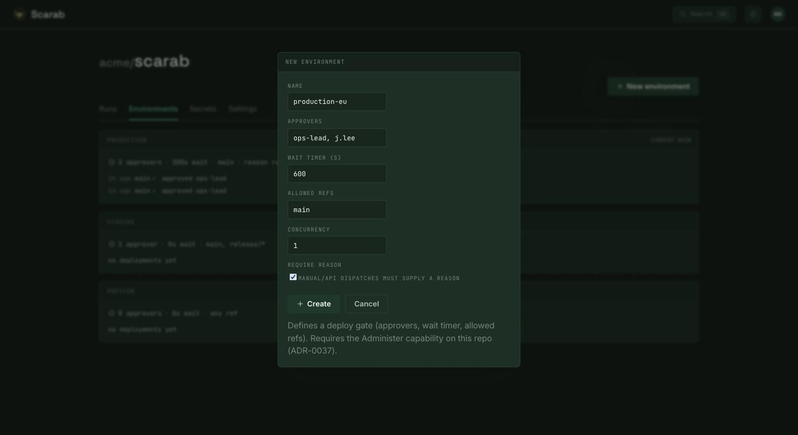

import Doodle from '../../../components/Doodle.astro';

<Doodle icon="shield-check" size={200} rotate={-8} opacity={0.18} top="7rem" right="-2rem" />

## What an Environment is

An Environment (for example `staging` or `prod`) is an **org-level set of rules and scoped
secrets that governs the Runs which name it**. A pipeline names one with a top-level
`environment:`:

```yaml
environment: prod
```

That one line pulls in approval, allowed refs, secrets and privilege grants, which an org admin
defines **once** for every Project in the org. Because the rules live in the Environment and not in
the pipeline YAML, you get separation of duties: the pipeline *asks* to run in `prod`, and the
Environment *decides* whether it may, whatever the YAML says.

Naming an Environment does not make a Run a deploy. A smoke test that needs staging credentials or
a backup that needs prod credentials runs in an Environment too. To mark the Runs that deploy, use
[`deploy: true`](/scarab-ci/usage/pipeline-syntax/#deploys-deploy-true). Scarab governs the Run that
deploys and keeps no record of what is live where after that Run ends; that is your CD tool's job.
See [Deploying with Argo CD](/scarab-ci/usage/deploying-with-argo-cd/) for a pipeline that waits
until its change is live.

Protection is **optional per Environment**. An Environment with no rules (typically `staging`) only
scopes secrets. Add approvers and it becomes gated.



## Who may run in it

An Environment admits Runs only from the Projects on its **eligibility** list: *all projects*, or
an explicit list (project-name globs allowed). A new Environment starts with **no** eligible
Projects, and a pipeline that names an unknown Environment, or one that doesn't admit its Project,
is refused before any Pod starts.

Org admins create Environments and edit their eligibility and rules, under the org's
**Settings → Environments**.

## The rules it holds

An Environment's baseline protection rules are:

- **`approvers`**: principals whose approval is required. Approvals are recorded on a gate, not in
  a separate table: a `manual` gate in the Run collects distinct approver identities on the Run's
  durable event log (`GateApproved { step, by }`), and the Run stays suspended until every named
  approver has approved. This survives restarts, and approvals cannot be forged.
- **`allowed_refs`**: glob patterns for the git refs that may run here; checked at **Run
  creation**, so a disallowed ref is rejected before any Pod launches (blank = any ref).
- **`require_reason`**: a human dispatch (`manual`/`api`) into this Environment must carry a
  reason; push, pull request, tag, release and cron are exempt.
- **`wait_timer_s`**: a wait in seconds. It is stored and merged but **not enforced yet**.

A Project's admins can add a **tighten-only overlay** for their Project: more approvers, a
narrower ref pattern, `require_reason`, a longer timer. An overlay can make that Project's Runs
stricter than the org baseline, never looser.

Two governed settings are granted **to one Project within one Environment**, and fail closed: the
privilege whitelist (which image digests may use the `add-capabilities` or `privileged` grants) and
permission for a raw `k8s_overlay`.

A Run that names an Environment is also never cancelled by newest-wins: a newer push to the same
branch does not cancel it, and its concurrency group queues even if the pipeline declares
`cancel-in-progress`.

## Scoped secrets

An Environment has two secret scopes: one shared by every eligible Project, and one per Project
within the Environment. A step resolves a key most specific first: **Project in the Environment →
Environment → Project → Org**. Prod credentials therefore exist only under the gated
Environment, and editing pipeline YAML cannot move them. See [Secrets](/scarab-ci/usage/secrets/).

## Admission at the point of use

The engine enforces admission itself; a caller can't satisfy it with a request body. Eligibility
and `allowed_refs` are checked at Run creation, `approvers` is satisfied by the gate approvals the
Run has collected, and `require_reason` is checked at the admission gate. Eligibility is checked
again when each step launches and when a manual or external gate is released, so a Project
removed from the list mid-Run stops before its next secret is used.

## API endpoints

Org Environments live under `/v1/orgs/{org}/environments` (writes need org admin):

| Method | Path | Purpose |
|---|---|---|
| `GET` | `/v1/orgs/{org}/environments` | List the org's Environments |
| `PUT` / `GET` / `DELETE` | `/v1/orgs/{org}/environments/{env}` | Create or replace, read, delete one |
| `PUT` / `GET` | `/v1/orgs/{org}/environments/{env}/protection` | The baseline protection rules |
| `PUT` / `GET` | `/v1/orgs/{org}/environments/{env}/eligibility` | Which Projects may run in it |
| `PUT` / `GET` / `DELETE` | `/v1/orgs/{org}/environments/{env}/projects/{project}/overlay` | One Project's tighten-only overlay |
| `PUT` / `GET` / `DELETE` | `/v1/orgs/{org}/environments/{env}/projects/{project}/privilege-grant` | One Project's privilege grant |
| `GET` | `/v1/repos/{org}/{repo}/environments` | The Environments a Project may use, with baseline, overlay and effective rules |

To list one Environment's Runs, filter the Project's Runs:
`GET /v1/repos/{org}/{repo}/runs?environment=prod`, or the Environment filter on the Runs tab.

## References

- [ADR-0037: Environment governance: scoped secrets, approval-as-gate, admission at point-of-use](/scarab-ci/tech/adr/0037-environment-governance/)
- [ADR-0071: Org-level Environments](/scarab-ci/tech/adr/0071-org-level-environments/)
- [ADR-0074: Deployments leave core](/scarab-ci/tech/adr/0074-deployments-leave-core/)
- [ADR-0014: Secrets: envelope-encrypted Postgres + pluggable providers](/scarab-ci/tech/adr/0014-secrets/)
- [ADR-0057: Run provenance: trigger context and origin details](/scarab-ci/tech/adr/0057-run-provenance-trigger-context/)
