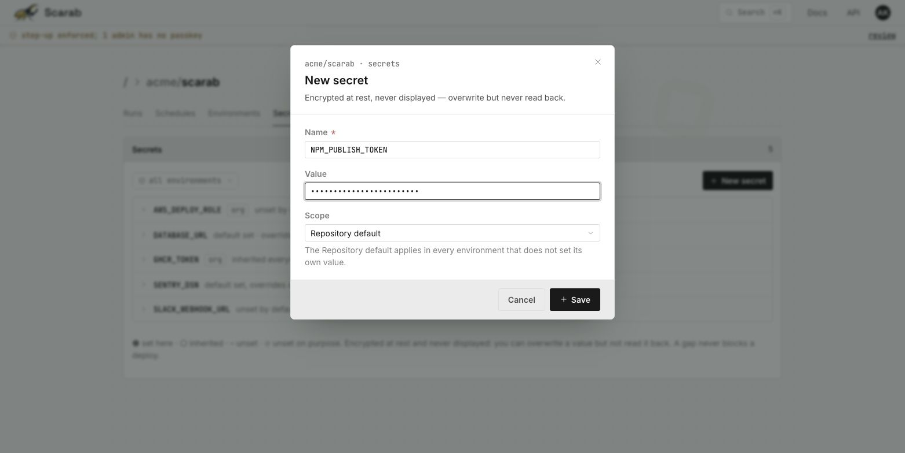

import Doodle from '../../../components/Doodle.astro';

<Doodle icon="key-round" size={200} rotate={9} opacity={0.18} top="7rem" right="-2rem" />

## What a secret is

A secret is a named credential Scarab stores on your behalf and hands to a step at run time:
a registry password, a deploy token, an API key. You give it a **name** (the key a step
references) and a **value**. Scarab stores it, scopes it, and injects it into the steps that ask
for it. A run from an untrusted fork's pull request never sees a secret.

## Encrypted at rest, write-only

Values are **encrypted with an envelope scheme in Postgres** (ADR-0014): a per-tenant data key encrypts the
value, and that key is wrapped by a master **KEK**, the base64 32-byte `SCARAB_MASTER_KEY`
(required in production; see [Environment Variables](/scarab-ci/usage/environment-variables/)).
Storage sits behind a pluggable `SecretProvider` port, so Vault, a cloud secret manager, or
the External-Secrets-Operator can drop in later without touching pipelines.

A secret value can be **written but never read back**. No API ever returns it: `POST /v1/secrets` takes the value,
but `GET /v1/secrets` lists **names only**, never values. The UI says so directly:

> Encrypted at rest, never displayed. Overwrite but never read back.

You can replace a value (the create form guards an overwrite of an existing name behind an
explicit opt-in), but you can never read the current one back. Log redaction tries to mask
known secret values out of the live and stored log stream.



## Scoping and inheritance

A secret is stored at one of four scopes:

| Scope | Set with | Who gets it |
|---|---|---|
| Org default | `org` | every repository, in every Environment |
| Org value for an Environment | `org` + `environment` | every repository's Runs in that Environment |
| Repository default | `org` + `repo` | that repository, in every Environment |
| Repository value for an Environment | `org` + `repo` + `environment` | that repository's Runs in that Environment |

A step resolves a key by walking from the most specific scope to the least, and the first value
found wins. For a Run of `web` in `production`:

```
web · production  →  production (org)  →  web default  →  org default
```

The org's value for an Environment comes before the repository default. A platform team can set
the production credential once for every repository, and a repository default meant for its
other Environments does not replace it. A repository that needs its own value in production sets
it for production. A value shared across Environments lives once at repo or org scope; only
values that differ are stored per Environment.

An Environment scope needs the Environment to exist: a write to an Environment the org does not
have is refused.

A pipeline references a key **without naming an environment**, and resolution picks the value by the run's
target [environment](/scarab-ci/usage/environments/), so there is no `_staging` / `_prod` naming
convention built into the YAML, and pipelines stay portable across environments.

## How a pipeline consumes them

A step names the keys it needs with `secrets: [KEY, ...]`; each is resolved against the run's scope
chain and mounted in that step's container as the file `/scarab/secrets/KEY` (with the local
executor, a file in the directory `$SCARAB_SECRETS` names). An entry written as
`{ name: KEY, env: true }` is also the environment variable `KEY`. The value is never written into
the Pod spec in either form. A key that resolves to nothing at
**every** scope is an error at submit or deploy time, never silently empty. A **run from a fork's
pull request is locked out** and receives none unless a maintainer approves. For the authoring YAML see
[Pipeline Syntax](/scarab-ci/usage/pipeline-syntax/).

## Where you set them: one key list

A repository's values live on its **Secrets** tab, as a list with one row per key. The org's
values live in the org's **Settings › Secrets** (`/orgs/<org>/settings/secrets`). The repository's
list includes the org's keys too, tagged `org` when the value a Run gets comes from the org.

The org's Secrets page has the same list as a repository's Secrets tab. Expanding a key shows the
**Org default**, then one line per Environment with the org's value for it. Each line says when a
repository sets its own value in front of it, for example `set here · web sets its own`, so you
can see where the org value does not reach. **New secret** asks for a name, a value and a
**Scope**: the Org default or one Environment. The page reads
`GET /v1/orgs/{org}/secrets/matrix`, which returns names, states and repository names only.

Each row has a one-line summary of where the key is set, for example `default set · overridden in
production` or `unset by default · set in staging and qa`. Click the row to expand it: one line per
scope, the **Repository default** first (the repo scope every Environment falls back to), then each
Environment. Each line shows the scope's state and what you can do there:

- **set** or **edit** a value at that scope,
- **clear** the value at that scope, after a confirmation that says what the key falls back to
  (for the Repository default, the org value if there is one; for an Environment, the Repository
  default),
- **unset on purpose** on a scope that resolves to nothing, and **unmark** to take that back.

Environments that only inherit, or are unset, fold behind one line such as "8 more inherited";
**show** lists them. This keeps a key readable when the repository has many Environments.

The **Environment** filter above the list picks one Environment. Every row's summary then says what
a Run in that Environment gets for the key and where it comes from: "set here", "from the
Repository default", "from the org", "from the org value for production", "unset" or "unset on
purpose". The choice is in the URL
(`?secret_env=<name>`), so you can send the view to someone.

**New secret** asks for a name, a value and a **Scope**: the Repository default or one
Environment. It starts on the Environment the filter picked. If the name is already set at that
scope, you have to tick a box to overwrite it.

Environments are configured for their **protection rules** (approvers, allowed refs, wait timers)
and nothing else. Secrets are one set of keys resolved by scope, not separate per-environment
lists, so you can tell whether production overrides the default by expanding one key.

Each scope line shows only *where a value lives*, never a value:

| | Meaning |
|---|---|
| `●` set here | a value at exactly this scope |
| `○` inherited | nothing here; it resolves from the Repository default or the org, and the line says which |
| `–` unset | resolves to nothing |
| `⊘` unset on purpose | a deliberate gap, marked so it is not mistaken for an oversight |

The list reads `GET /v1/repos/{org}/{repo}/secrets/matrix`, which returns names and states only.
It is advisory and never blocks a deploy. The check that enforces completeness runs at submit or
deploy time: every key a pipeline *references* must resolve.

## References

- [ADR-0014, Secrets: envelope-encrypted Postgres + pluggable providers](/scarab-ci/tech/adr/0014-secrets/)
- [ADR-0037, Environment governance: scoped secrets, approval-as-gate, admission at point-of-use](/scarab-ci/tech/adr/0037-environment-governance/)
- [ADR-0060, Org settings: connection lifecycle, org/env secret editing, IaC-or-UI connections](/scarab-ci/tech/adr/0060-org-settings-connections-and-secret-management/)
